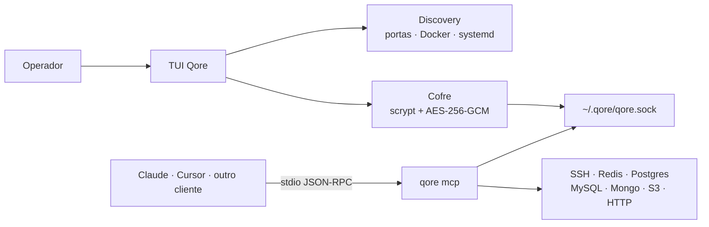
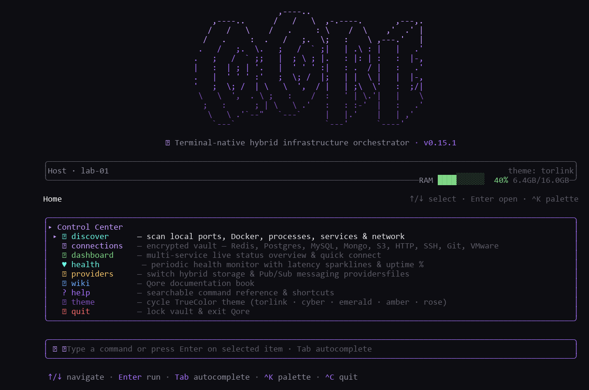
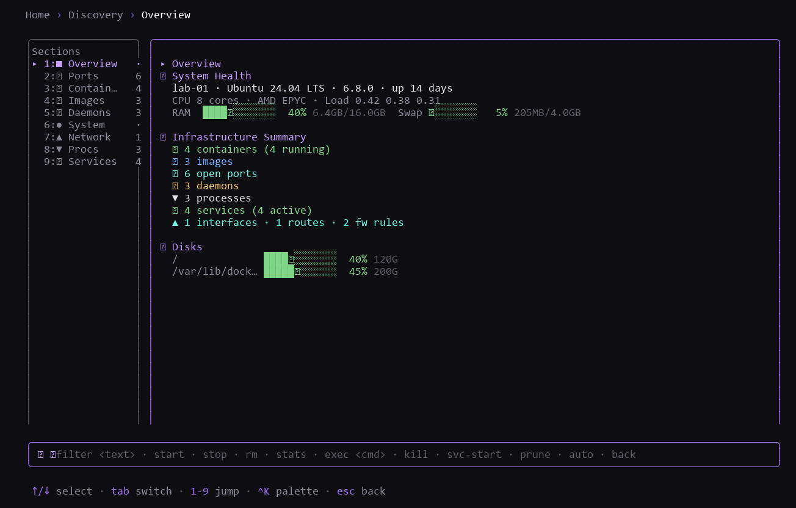
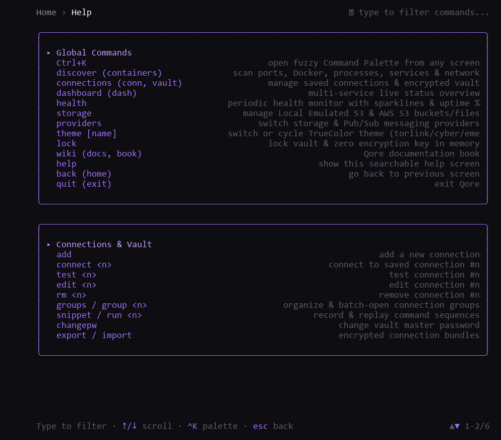

<div align="center">


# Qore

**Orquestrador de infraestrutura em um único binário — TUI no terminal, cofre criptografado e servidor MCP que opera a máquina sem entregar credenciais ao modelo.**

[](https://github.com/Luizfelipereal007/qore/actions/workflows/ci.yml)
[](https://bun.sh)
[](https://www.typescriptlang.org)
[](https://react.dev)
[](https://github.com/vadimdemedes/ink)
[](LICENSE)

[Visão geral](#-visão-geral) ·
[Interface](#-interface) ·
[Funcionalidades](#-funcionalidades) ·
[Arquitetura](#-arquitetura) ·
[Começando](#-começando) ·
[Configuração](#-configuração) ·
[MCP](#-servidor-mcp) ·
[CI/CD](#-cicd-github-actions)

</div>

---

## 📋 Índice

- [Visão geral](#-visão-geral)
- [Interface](#-interface)
- [Funcionalidades](#-funcionalidades)
- [Arquitetura](#-arquitetura)
- [Stack](#-stack)
- [Começando](#-começando)
- [Configuração](#-configuração)
- [Servidor MCP](#-servidor-mcp)
- [Estrutura do projeto](#-estrutura-do-projeto)
- [CI/CD (GitHub Actions)](#-cicd-github-actions)
- [Segurança](#-segurança)

---

## 🔭 Visão geral

O Qore junta descoberta local, um cofre de conexões e o controle dos serviços numa TUI (Ink). O mesmo processo sobe um servidor [MCP](https://modelcontextprotocol.io) para o cliente de IA operar a infraestrutura pelo nome da conexão — o modelo não recebe senha, chave nem token.



1. **Descubra** — `discover` varre portas TCP, containers Docker pelo socket, daemons pm2/systemd, processos, serviços, rede e o host.
2. **Guarde** — as conexões ficam no cofre (`~/.qore/vault.enc`). A senha mestra não é escrita em disco; a chave some da memória no lock.
3. **Opere** — abra Redis, PostgreSQL, MySQL, MongoDB, S3, HTTP, SSH, Git ou vSphere na TUI, ou destrave o cofre e deixe o MCP executar pelo nome da conexão.

A referência de comandos dentro do produto é a tela `help` (busca ao digitar) e o livro `wiki`. O catálogo das tools MCP está em [`docs/mcp.md`](docs/mcp.md).

---

## 🖼️ Interface

Tema padrão **Torlink**. As telas abaixo foram renderizadas com dados de demonstração (`lab-01`), não com o host de quem clonou o repositório.

<p align="center">
  
</p>

Tela inicial — telemetria do host, cofre e o menu do control center.

<p align="center">
  
</p>

Discovery — sidebar com as nove seções e o panorama de containers, portas, daemons e discos.

<p align="center">
  
</p>

Ajuda — comandos com descrição. Digitar filtra; `↑/↓` percorre o restante.

---

## ✨ Funcionalidades

| Área | Recursos |
| --- | --- |
| **Discovery** | Portas TCP, containers e imagens Docker via `/var/run/docker.sock` (sem CLI `docker`), daemons pm2/systemd, CPU/memória/disco, rede, processos e serviços |
| **Cofre** | Conexões em AES-256-GCM, troca de senha mestra, import/export no formato QOREX1, grupos e abertura em lote |
| **Sessões** | Várias conexões ao mesmo tempo, abas com `Ctrl+Tab`, mais de uma sessão da mesma conexão (`new`) |
| **Dados** | Redis (RESP), PostgreSQL, MySQL, MongoDB — tabelas, `query`, CSV, `EXPLAIN`, queries lentas |
| **SSH** | Shell interativo, SFTP, systemd, Docker e Compose no host remoto, auditoria, snapshots e diff |
| **Objetos e Git** | S3 compatível (upload, download, presign SigV4) e operações Git com árvore ASCII de branches |
| **vSphere** | VMs, snapshots, hosts, datastores, redes, eventos e tasks pela API REST |
| **Operação** | Dashboard de status, health check com sparkline e uptime, favoritos, snippets, temas TrueColor, `qore update` |
| **MCP** | 40 tools, 5 resources e 4 prompts em JSON-RPC 2.0 por stdio. O modelo cita o nome da conexão |

Drivers de conexão: Redis, PostgreSQL, MySQL, MongoDB, S3, HTTP, SSH, Git e VMware vSphere.

---

## 🏗️ Arquitetura

Um processo Bun. A TUI segura o cofre aberto; o MCP é outro processo, filho do cliente de IA, e só lê conexão quando o socket está no ar.

```text
┌──────────────────────────────────────────────────────────┐
│  qore                                                    │
│  ├── ui/          TUI Ink (telas, paleta, temas)         │
│  ├── core/        discovery, drivers, cofre, health      │
│  ├── mcp/         JSON-RPC stdio → tools/resources       │
│  └── cli/         qore update · qore mcp                 │
└───────────────┬──────────────────────────┬───────────────┘
                │ ~/.qore/qore.sock 0600   │
                ▼                          ▼
         cofre na memória            SSH · bancos · Docker · HTTP
```

- **Protocolo nativo.** Redis, Postgres, Mongo, S3 e SSH falam o protocolo do serviço. Git usa o binário `git` da máquina.
- **Docker local** entra pelo socket Unix, não por um wrapper da CLI.
- **Binário único** com `bun build --compile`, depois do patch em `scripts/prebuild.sh` (remove o devtools do Ink e ajusta stdin no binário compilado).
- **Isolamento do MCP.** A tool recebe o nome da conexão. A resposta volta com o resultado da operação. Segredo não entra no texto devolvido ao modelo. Cofre fechado: as tools que dependem dele respondem que é preciso destrancar na TUI.

---

## 🧰 Stack

| Camada | Tecnologias |
| --- | --- |
| Runtime | Bun 1.2 (CI fixa `1.2.0`) · TypeScript 5.5 |
| Interface | React 18 · Ink 5 |
| Dados | `pg` · `mysql2` · `mongodb` · Redis RESP · `bun:sqlite` no S3 local |
| Acesso remoto | `ssh2` · Git CLI · API REST do vSphere |
| Cofre | `node:crypto` — scrypt + AES-256-GCM |
| Entrega | GitHub Actions · binários linux-x64, linux-arm64, darwin-arm64, windows-x64 |

---

## 🚀 Começando

### Pré-requisitos

- **Binário:** nada além do script de instalação.
- **Fonte:** [Bun](https://bun.sh) 1.2 ou superior. `bun run build` chama `bash` (`scripts/prebuild.sh`) — no Windows, Git Bash.

O grupo `docker` só importa se for listar containers locais:

```bash
sudo usermod -aG docker "$USER"
```

### Binário

Os scripts do repositório baixam o release publicado em [`Kodjaoglanian/qore`](https://github.com/Kodjaoglanian/qore/releases). Linux e macOS:

```bash
curl -fsSL https://github.com/Kodjaoglanian/qore/releases/latest/download/install.sh | bash
```

Windows (PowerShell):

```powershell
irm https://github.com/Kodjaoglanian/qore/releases/latest/download/install.ps1 | iex
```

O instalador coloca o binário em `~/.local/bin/qore` ou em `%LOCALAPPDATA%\Qore`. Em seguida:

```bash
qore
qore update
```

### Fonte

```bash
git clone https://github.com/Luizfelipereal007/qore.git
cd qore
bun install
bun run dev
```

### Scripts úteis

| Comando | Ação |
| --- | --- |
| `bun run dev` / `bun run start` | Sobe a TUI |
| `bun run tsc` | Checagem de tipos, sem emitir JS |
| `bun test` | Testes (`tests/`) |
| `bun run build` | Patch do Ink + binário `qore` na raiz |
| `bun run pretag` | `tsc` + testes, usado antes de taguear |
| `bun run release:patch` / `release:minor` | Versão, tag `v*` e push de `main` |

### Comandos da TUI

Barra no rodapé. Enter executa, Esc volta, `Ctrl+C` sai, `Ctrl+K` abre a paleta.

| Comando | O que faz |
| --- | --- |
| `discover` | Varre portas, Docker, daemons, host, rede, processos e serviços |
| `connections` | Cofre: criar, testar, agrupar, importar e exportar |
| `dashboard` | Status das conexões salvas (cofre aberto) |
| `health` | Health check com histórico e sparkline |
| `storage` / `providers` | S3 local (SQLite) ou AWS, e Pub/Sub |
| `wiki` / `help` | Livro interno e referência filtrável |
| `theme` | Cicla torlink, cyber, emerald, amber, rose |
| `quit` | Tranca o cofre e encerra |

No discovery, `1`–`9` ou `Tab` trocam a seção (Overview, Ports, Containers, Images, Daemons, System, Network, Procs, Services). `help` lista o restante: SQL, Redis, S3, SSH, Git e vSphere.

---

## ⚙️ Configuração

Não há `.env` de aplicação. O estado fica em `~/.qore/` (ou no diretório de `QORE_HOME`).

| Variável | Descrição | Padrão |
| --- | --- | --- |
| `QORE_HOME` | Diretório de dados | `~/.qore` |
| `QORE_SOCKET_PATH` | Socket da ponte do cofre para o MCP | `~/.qore/qore.sock` |
| `QORE_LOG_LEVEL` | Log do MCP: `debug`, `info`, `warn`, `error` | `info` |
| `AWS_REGION` | Região do provider S3 da AWS | `us-east-1` |
| `EDITOR` | Editor do `edit` no SSH | `nano` |

`~/.qore/config.json` guarda `theme`, `autoProbeOnStart` e `checkUpdates`. Credenciais AWS de S3 em nuvem continuam em `~/.aws/credentials`, perfil `default`.

| Caminho | Conteúdo |
| --- | --- |
| `vault.enc` / `vault.meta.json` | Cofre e metadados (salt, nonce). Meta gravado com modo `0600` |
| `qore.sock` | Socket da ponte, modo `0600`, removido no lock e na saída |
| `storage/` e `metadata.db` | Objetos e índice do S3 local |
| `favorites.json` / `snippets.json` / `health.json` | Favoritos, macros e histórico de health |

---

## 📡 Servidor MCP

Com a TUI aberta e o cofre destrancado:

```bash
qore mcp --help
```

Cursor (`.cursor/mcp.json`):

```json
{
  "mcpServers": {
    "qore": {
      "command": "qore",
      "args": ["mcp"]
    }
  }
}
```

O código também documenta Claude Desktop e Windsurf em [`docs/mcp.md`](docs/mcp.md).

| Grupo | Quantidade | Exemplos |
| --- | --- | --- |
| SSH | 6 | `ssh_exec`, `ssh_upload`, `ssh_download`, `ssh_get_info` |
| Docker | 11 | `docker_list`, `docker_logs`, `docker_stats`, `docker_prune` |
| Banco | 5 | `db_list_databases`, `db_query`, `db_table_sample` |
| Sistema | 7 | `sys_processes`, `sys_service_control`, `sys_disk_usage` |
| Discovery | 7 | `discover_ports`, `discover_containers`, `discover_network` |
| HTTP | 4 | `http_get`, `http_post`, `http_put`, `http_delete` |

Resources: conexões, último probe, containers, imagens e info do sistema. Prompts: `diagnose_infra`, `security_audit`, `container_health`, `db_health_check`.

---

## 📁 Estrutura do projeto

```text
src/
  index.tsx                 entrada da TUI
  cli/update.ts             qore update e argumentos
  core/
    orchestrator.ts         discovery
    probe/                  portas, Docker, daemons, host, rede, processos
    connections/            redis, postgres, mysql, mongo, s3, http, ssh, git, vmware
    vault/                  cripto, arquivo cifrado, socket da ponte
    providers/              S3 local, S3 AWS, Pub/Sub em memória
  mcp/                      servidor JSON-RPC e tools
  ui/                       telas Ink e componentes
tests/                      bun:test
scripts/                    install.sh, install.ps1, prebuild.sh
docs/mcp.md                 contrato do MCP
.github/workflows/          ci.yml, build.yml, release.yml
```

---

## 🔄 CI/CD (GitHub Actions)

Bun fixo em **1.2.0**. Três workflows:

| Job | Runner | Gatilho | O que faz |
| --- | --- | --- | --- |
| `quality` | `ubuntu-latest` | push e PR em `main` | `bun run tsc` e `bun test` |
| `build-smoke` | `ubuntu-latest` | depois de `quality` | compila `bun-linux-x64` e confere o binário |
| `build` | matriz | `workflow_call` (o release chama) | `qore-linux-x64`, `qore-linux-arm64`, `qore-darwin-arm64`, `qore-windows-x64.exe` |
| `release` | `ubuntu-latest` | tag `v*.*.*` | baixa os artefatos, gera changelog e publica o GitHub Release |

`bun run release:patch` e `bun run release:minor` rodam `pretag`, sobem a versão no `package.json`, criam a tag e fazem push de `main` com as tags. O release no GitHub é o workflow da tag.

---

## 🛡️ Segurança

- Senha mestra só em memória. Derivação scrypt (`N = 2^17`, `r = 8`, `p = 1`) e cifra AES-256-GCM. `zeroKey` zera o buffer da chave no lock, na troca de senha e no fim das operações do cofre.
- `vault.meta.json` e o socket saem com modo `0600`. O socket é apagado no lock, na saída e em `SIGINT`/`SIGTERM`.
- Tools MCP não devolvem segredo. Sem o cofre aberto, a tool que precisa de conexão para.
- Exportação de conexões sai no pacote cifrado QOREX1, não em JSON claro.
- vSphere com `extra.insecure` definido como `true` ou `yes` desliga a verificação TLS **do processo** (`NODE_TLS_REJECT_UNAUTHORIZED=0`). Isso vale para o restante das conexões HTTPS daquela execução. Deixe desligado fora de laboratório com certificado autoassinado.
- Reboot e shutdown remotos pedem confirmação explícita (`reboot yes`, `shutdown yes`).

---

<div align="center">

**Qore** — infraestrutura no terminal, cofre fechado, modelo sem a senha.

[github.com/Luizfelipereal007/qore](https://github.com/Luizfelipereal007/qore) · [MIT](LICENSE)

</div>
